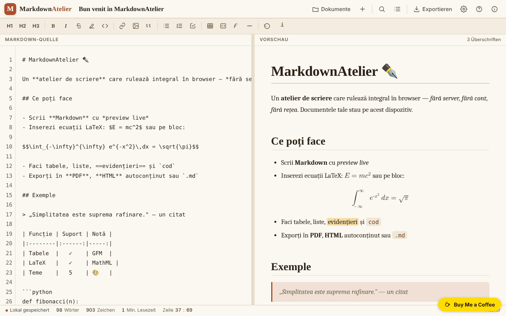

# MarkdownAtelier

[English](README.md) · [Română](README.ro.md) · [Français](README.fr.md) · [Italiano](README.it.md) · [Español](README.es.md) · [Português](README.pt.md) · **Deutsch** · [Magyar](README.hu.md)

**Version:** 1.2.8 · **Zuletzt aktualisiert:** 2026-10-23

Oberflächensprachen: **Română, English, Français, Italiano, Español, Português (PT), Deutsch, Magyar**

Markdown-Schreibwerkstatt mit Vorschau, Export und lokal gespeicherten Dokumenten.

**Online:** https://chiuta.github.io/MarkdownAtelier/

## Was es ist

MarkdownAtelier ist ein Markdown-Editor in einer einzigen HTML-Datei, mit paralleler Vorschau, Dokumentenverwaltung, Suchen/Ersetzen und Export nach .md, .html und PDF (über den Druck). Ihre Dokumente bleiben in Ihrem Browser.

## Funktionen

- Editor („Editor“) und Vorschau („Preview“), mit optional synchronisiertem Scrollen und „Fokusmodus“.
- Formatierungsleiste (H1, H2, H3, B, I usw.), Zähler für Wörter, Zeichen und Lesedauer in Minuten, Anzeige „Zeile : Spalte“.
- Syntax: Überschriften, Fett, Kursiv, Durchgestrichen, ==Hervorgehoben==, Inline-Code, ~tiefgestellt~, ^hochgestellt^, Listen und Checklisten, Zitate, GFM-Tabellen, Fußnoten, Codeblöcke mit Sprache, Gleichungen `$inline$` und `$$Block$$` (LaTeX in natives MathML umgewandelt), automatisches Inhaltsverzeichnis `[[toc]]`, aufklappbare Details `::: details`.
- Einstellungen: Thema, Sprache der Oberfläche (English, Română, Français, Italiano, Español, Português, Deutsch, Magyar), Zeilenumbruch, Zeilennummern, automatische Nummerierung der Überschriften im Inhaltsverzeichnis, intelligente Typografie, Emoji-Codes (`:rocket:` wird zu 🚀), Textgröße.
- Dokumente: „.md importieren“, „＋ Neues Dokument“, Dokumentliste mit Suche (in Titeln und Text), „Backup .json“ (alle Dokumente in einer Datei) und „Wiederherstellen“ (fügt die Dokumente aus einer Sicherung hinzu, ohne die vorhandenen zu überschreiben).
- Beim ersten Start, ohne gespeicherte Einstellungen, wählt die Anwendung das dunkle Thema „midnight“, wenn das System es bevorzugt.
- Export: .md, eigenständiges .html, PDF (Druck), „HTML in die Zwischenablage kopieren“; Inhaltsverzeichnis-Panel und Syntaxhilfe.

## Neue Funktionen (1.1.0)

- **Lokale Prüfung auf personenbezogene Daten vor Export oder Kopieren** (`FFF.pii`): Bei „↓ .md“, „↓ .html“, „🖨 PDF“ und „HTML kopieren“ (und bei Strg+Umschalt+P) sucht die Anwendung im Browser nach E-Mail-Adressen, Telefonnummern, IBAN (mod 97), CNP (Prüfziffer), Karten (Luhn), IP-Adressen, Schlüsseln/Tokens, Anschriften und Namen (letztere mit geringer Sicherheit). Findet sie etwas, exportiert sie nicht, bis Sie wählen: „Markierte maskieren und fortfahren“, „Ohne Maskierung fortfahren“ oder „Abbrechen“. **Das Dokument im Editor wird nicht verändert**: Es wird nur eine maskierte Kopie exportiert. Die Option lässt sich im Export-Panel abschalten (die Einstellung bleibt erhalten).
- **„🛡 Dokument jetzt prüfen“** (Export-Panel): scannt das aktuelle Dokument; findet es personenbezogene Daten, können Sie ein **neues Dokument** mit maskierten Daten erstellen (das Original bleibt unberührt).
- **Lokale Bedeutungssuche in Dokumenten** (`FFF.search`: BM25, Normalisierung diakritischer Zeichen, ähnliche Formen, hervorgehobene Ausschnitte; ohne Netzwerk). Sie ersetzt den einfachen Teilstring-Abgleich, mit derselben Oberfläche; fehlt das Kit, wird die alte Variante verwendet.
- **Datenschutz-Anzeige** im Panel „Dokumente“: Die Dokumente bleiben auf dem Gerät, die Anwendung stellt keine Netzwerkanfragen (CSP: `default-src 'self'`, kein `connect-src`; im Test geprüft: 0 Anfragen). Das Transparenz-Label (die Version unter „Info“ drücken) bietet `.fff.json`-Export/-Import/-Löschung mit optionaler Passwortverschlüsselung (AES-GCM, PBKDF2).
- **Barrierefreiheit:** Die modalen Fenster haben jetzt `role="dialog"`, `aria-modal` und einen Namen, und die Benachrichtigung (`#toast`) ist eine `status`-Region; axe-core: 0 Verstöße (vorher hatte das Export-Panel einen „region“-Verstoß).

### 1.2.2 — 2026-10-22
- Tooltips der Werkzeug- und Suchleiste, Barrierefreiheits-Beschriftungen, Platzhalter des Editors, Syntaxhilfe, Schaltflächen der Codeblöcke sowie Seitentitel und -beschreibung sind in alle Sprachen übersetzt; das unveränderte Willkommensdokument folgt der Oberflächensprache.

### Grenzen
- Die Erkennung personenbezogener Daten ist heuristisch: Sie kann etwas übersehen oder fälschlich melden. Sie ersetzt nicht Ihre eigene Prüfung vor der Veröffentlichung eines Textes.
- Es wird nur der Markdown-Text gescannt, nicht Bilder oder per data-URI angehängte Dateien.
- Die Übersetzungen der neuen Texte in fr/it/es/pt/de/hu sind automatisch und **nicht muttersprachlich geprüft**.

**FFF-Kit.** Aus dem `fff-kit` (in `index.html` eingefügt, ohne Netzwerk) werden `core, label, bundle, pii, search` verwendet. Die CSP-Richtlinie wurde **nicht geändert**, abgesehen von den `sha256`-Hashes der Inline-Skripte (der Stil des Dialogs für personenbezogene Daten wird in `<style>` eingefügt, abgedeckt durch das bereits vorhandene `style-src 'unsafe-inline'`; kein neuer Host).

## Bedienungsanleitung

Tastenkürzel (in der Anwendung angezeigt):

- Strg B fett, Strg I kursiv, Strg K Link, Strg ` Inline-Code
- Strg F suchen / ersetzen
- Strg S speichern
- Strg E exportieren
- Strg O Dokumente
- Strg Alt N neues Dokument
- Tab einrücken

Schritte:

1. Schreiben Sie im Panel „Markdown-Quelle“; die Vorschau erscheint daneben; die Umschalter ✍️ Editor und 👁️ Preview wählen das angezeigte Panel.
2. Verwalten Sie Dokumente unter „Dokumente“ (Strg O): „.md importieren“ oder „＋ Neues Dokument“.
3. Exportieren Sie unter „Export“ (Strg E): „↓ .md“, „↓ .html“, „🖨 PDF“ (im Druckdialog „Als PDF speichern“ wählen) oder „⧉ Kopieren“.
4. Passen Sie Thema, Sprache und Optionen unter „Einstellungen“ an.
5. Um alles zu löschen, was die Anwendung gespeichert hat, verwenden Sie „Alle Daten löschen“ in den Einstellungen.

## Datenschutz und Netzwerk

- Dokumente und Einstellungen werden in `localStorage` gespeichert (Schlüssel `markdownatelier.v1` und `markdownatelier.settings.v1`); die Anzeige „Lokal gespeichert“ zeigt den Status.
- Die CSP-Richtlinie erlaubt keine beliebigen Inline-Skripte mehr (`script-src` per SHA-256-Hash, kein `'unsafe-inline'`).
- Die Anwendung stellt keine Netzwerkanfragen (kein `fetch`, keine CDNs oder externen Skripte). Sie enthält nur Links, die beim Klicken geöffnet werden, zu Buy Me a Coffee und chiuta.github.io.
- Die Daten werden nicht zwischen Geräten synchronisiert; für eine Sicherung exportieren Sie die Dateien.

## Lokale Ausführung / offline

Laden Sie `index.html` herunter und öffnen Sie sie in einem Browser; kein Internet erforderlich.

## Verlauf / Changelog

### 1.2.8 — 2026-10-23

- fff-kit-1.2.0-Audit: Die i18n-Paritätswarnung ist ein Fehlalarm (die Schlüssel werden zur Laufzeit ergänzt); als begründete Ausnahme in `fff.config.json` dokumentiert. Keine funktionale Änderung.

### 1.2.6 — 2026-10-22

fff-kit 1.1.4: Touch-Ziele und Mindestschriftgröße. Touch-Ziele/Text in der App korrigiert.

### 1.2.5 — 2026-10-22

fff-kit 1.1.2: PBKDF2 mit 600.000 Iterationen, Schutz vor Clickjacking.

### 1.2.4 — 2026-10-22
- Nur ein H1 pro Seite: Ein „# Titel“ im Dokument erscheint in der Vorschau als H2 mit gleichem Aussehen.
- Auf schmalen Bildschirmen bricht die Formatierungsleiste um, statt seitlich abgeschnitten zu werden; die Schaltflächen sind größer (36 px).
- Die nativen confirm()-Dialoge (Dokument löschen, alles löschen) wurden durch einen barrierefreien, übersetzten Dialog ersetzt.
- Mobil: kein Text unter 12 px und Touch-Ziele von mindestens 24 px (WCAG 2.5.8).

- **1.2.3 — 2026-10-22:** die Schaltflächen „Ersetzen“ und „Alle“ der Suchleiste sowie das Barrierefreiheits-Label der Sprachauswahl sind jetzt in alle Sprachen übersetzt (keine rumänischen Reste mehr).
- **1.1.0 — 2026-10-14:** lokale Prüfung auf personenbezogene Daten vor Export/Kopieren (`FFF.pii`), „Jetzt prüfen“ mit neuem maskiertem Dokument, lokale Bedeutungssuche (`FFF.search`), Datenschutz-Anzeige, Transparenz-Label und verschlüsselte Sicherung (`FFF.bundle`), `role="dialog"` an den Fenstern; Tests in `tests/fff-r8.test.mjs`.
- 1.0.0 — 2026-10-12: Die Version und das Datum der letzten Aktualisierung werden in der Anwendung angezeigt
- Runde 7: `~tiefgestellt~` funktioniert auch mitten in Wörtern (H~2~O, CO~2~); ein neues Dokument erhält automatisch den Titel der ersten Markdown-Überschrift (`# ...`), solange der Titel nicht manuell bearbeitet wurde; besserer Kontrast für ~~durchgestrichenen~~ Text.
- Auf schmalen Bildschirmen (360 px) ragen die obere Leiste und die Statusleiste nicht mehr über den Bildschirm hinaus; der Dokumenttitel wechselt in eine eigene Zeile, und die Schaltfläche Einstellungen ist sichtbar.
- Der Umschalter „Editor / Preview“ erscheint jetzt auf Mobilgeräten (er war durch eine überschriebene CSS-Regel verborgen).
- Dokumente: Suche in Titeln/Inhalt, Backup .json und Wiederherstellen (mit Validierung und Fehlermeldung); standardmäßig dunkles Thema beim ersten Start, wenn das System es bevorzugt; CSP `script-src` per Hash statt `'unsafe-inline'`.
- Eine Überschrift der Ebene 1 (visuell verborgen) für Screenreader hinzugefügt; axe-core-Prüfung: 0 Verstöße bei 1280 und 360 px.

## Lizenz

MIT — siehe Datei LICENSE

## Autor

Alexio — Alexandru-Ionuț Chiuță, Kontakt: alexio@trom.tf

## Zusammenfassung

MarkdownAtelier ist ein Markdown-Editor in einer einzigen Datei mit Live-Vorschau, Dokumentenverwaltung, Suchen/Ersetzen, LaTeX-zu-MathML-Formeln, Tabellen, Fußnoten und Export nach .md, .html und PDF (über den Druck). Die Dokumente werden im localStorage des Browsers gespeichert. 8 Oberflächensprachen. Keine Netzwerkanfragen.
