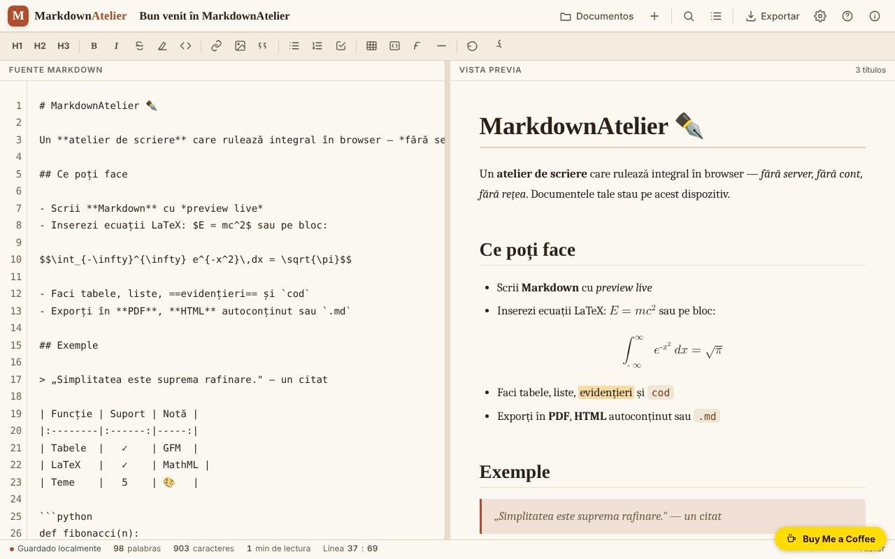

# MarkdownAtelier

[English](README.md) · [Română](README.ro.md) · [Français](README.fr.md) · [Italiano](README.it.md) · **Español** · [Português](README.pt.md) · [Deutsch](README.de.md) · [Magyar](README.hu.md)

**Versión:** 1.2.6 · **Última actualización:** 2026-10-22

Idiomas de la interfaz: **Română, English, Français, Italiano, Español, Português (PT), Deutsch, Magyar**

Taller de escritura Markdown con vista previa, exportación y documentos guardados localmente.

**En línea:** https://chiuta.github.io/MarkdownAtelier/

## Qué es

MarkdownAtelier es un editor Markdown en un solo archivo HTML, con vista previa en paralelo, gestor de documentos, búsqueda/reemplazo y exportación a .md, .html y PDF (mediante impresión). Los documentos permanecen en tu navegador.

## Funciones

- Editor («Editor») y vista previa («Preview»), con desplazamiento sincronizado opcional y «Modo foco».
- Barra de formato (H1, H2, H3, B, I etc.), contador de palabras, caracteres y minutos de lectura, indicador «Línea : columna».
- Sintaxis: títulos, negrita, cursiva, tachado, ==resaltado==, código en línea, ~subíndice~, ^superíndice^, listas y listas de tareas, citas, tablas GFM, notas al pie, bloques de código con lenguaje, ecuaciones `$en línea$` y `$$bloque$$` (LaTeX convertido a MathML nativo), índice automático `[[toc]]`, detalles plegables `::: details`.
- Ajustes: tema, idioma de la interfaz (English, Română, Français, Italiano, Español, Português, Deutsch, Magyar), ajuste de línea, números de línea, autonumeración de los títulos en el índice, tipografía inteligente, códigos emoji (`:rocket:` se convierte en 🚀), tamaño del texto.
- Documentos: «Importar .md», «＋ Documento nuevo», lista de documentos con búsqueda (en títulos y texto), «Backup .json» (todos los documentos en un archivo) y «Restaurar» (añade los documentos de una copia, sin sobrescribir los existentes).
- En la primera ejecución, sin ajustes guardados, la aplicación elige el tema oscuro «midnight» si el sistema lo prefiere.
- Exportación: .md, .html autónomo, PDF (impresión), «Copiar HTML al portapapeles»; panel de índice y ayuda de sintaxis.

## Novedades (1.1.0)

- **Comprobación local de datos personales antes de exportar o copiar** (`FFF.pii`): en «↓ .md», «↓ .html», «🖨 PDF» y «Copiar HTML» (y en Ctrl+Mayús+P), la aplicación busca en el navegador correos electrónicos, teléfonos, IBAN (mod 97), CNP (dígito de control), tarjetas (Luhn), IP, claves/tokens, direcciones y nombres (estos últimos con baja confianza). Si encuentra algo, no exporta hasta que elijas: «Enmascarar los marcados y continuar», «Continuar sin enmascarar» o «Cancelar». **El documento del editor no se modifica**: solo se exporta una copia enmascarada. La opción se puede desactivar desde el panel Exportar (la preferencia se conserva).
- **«🛡 Comprobar ahora el documento»** (panel Exportar): analiza el documento actual; si encuentra datos personales, puedes crear un **documento nuevo** con ellos enmascarados (el original queda intacto).
- **Búsqueda local por significado en los documentos** (`FFF.search`: BM25, normalización de diacríticos, formas cercanas, fragmentos resaltados; sin red). Sustituye la simple coincidencia de subcadena, con la misma interfaz; si falta el kit, se usa la variante antigua.
- **Indicador de privacidad** en el panel «Documentos»: los documentos permanecen en el dispositivo, la aplicación no hace solicitudes de red (CSP: `default-src 'self'`, sin `connect-src`; verificado en pruebas: 0 solicitudes). La etiqueta de transparencia (pulsa la versión en «Acerca de») ofrece exportación/importación/eliminación `.fff.json` con cifrado opcional con contraseña (AES-GCM, PBKDF2).
- **Accesibilidad:** las ventanas modales tienen ahora `role="dialog"`, `aria-modal` y un nombre, y la notificación (`#toast`) es una región `status`; axe-core: 0 infracciones (antes el panel Exportar tenía una infracción «region»).

### 1.2.2 — 2026-10-22
- Las descripciones emergentes de la barra de herramientas y la búsqueda, las etiquetas de accesibilidad, el texto de ayuda del editor, la ayuda de sintaxis, los botones de los bloques de código y el título/la descripción de la página están traducidos a todos los idiomas; el documento de bienvenida sin modificar sigue el idioma de la interfaz.

### Límites
- La detección de datos personales es heurística: puede pasar por alto o señalar erróneamente. No sustituye tu comprobación antes de publicar un texto.
- Solo se analiza el texto Markdown, no las imágenes ni los archivos adjuntos mediante data-URI.
- Las traducciones de los textos nuevos en fr/it/es/pt/de/hu son automáticas y **no están verificadas por nativos**.

**Kit FFF.** Del `fff-kit` (pegado en `index.html`, sin red) se usan `core, label, bundle, pii, search`. La política CSP **no se ha cambiado**, salvo los hashes `sha256` de los scripts en línea (el estilo del cuadro de datos personales se inyecta en `<style>`, cubierto por el `style-src 'unsafe-inline'` ya presente; ningún host nuevo).

## Manual de uso

Atajos de teclado (mostrados en la aplicación):

- Ctrl B negrita, Ctrl I cursiva, Ctrl K enlace, Ctrl ` código en línea
- Ctrl F buscar / reemplazar
- Ctrl S guardar
- Ctrl E exportar
- Ctrl O documentos
- Ctrl Alt N documento nuevo
- Tab sangría

Pasos:

1. Escribe en el panel «Fuente Markdown»; la vista previa aparece al lado; los conmutadores ✍️ Editor y 👁️ Preview eligen el panel mostrado.
2. Gestiona los documentos desde «Documentos» (Ctrl O): «Importar .md» o «＋ Documento nuevo».
3. Exporta desde «Exportar» (Ctrl E): «↓ .md», «↓ .html», «🖨 PDF» (en el cuadro de impresión elige «Guardar como PDF») o «⧉ Copiar».
4. Ajusta el tema, el idioma y las opciones en «Ajustes».
5. Para borrar todo lo que la aplicación ha guardado, usa «Borrar todos los datos» en Ajustes.

## Privacidad y red

- Los documentos y los ajustes se guardan en `localStorage` (claves `markdownatelier.v1` y `markdownatelier.settings.v1`); el indicador «Guardado localmente» muestra el estado.
- La política CSP ya no permite scripts en línea arbitrarios (`script-src` por hash SHA-256, sin `'unsafe-inline'`).
- La aplicación no hace solicitudes de red (sin `fetch`, CDN ni scripts externos). Solo contiene enlaces, que se abren al hacer clic, a Buy Me a Coffee y chiuta.github.io.
- Los datos no se sincronizan entre dispositivos; para la copia de seguridad, exporta los archivos.

## Ejecución local / sin conexión

Descarga `index.html` y ábrelo en un navegador; no requiere internet.

## Historial / Changelog

### 1.2.6 — 2026-10-22

fff-kit 1.1.4: áreas táctiles y texto mínimo. Áreas táctiles/texto corregidos en la aplicación.

### 1.2.5 — 2026-10-22

fff-kit 1.1.2: PBKDF2 con 600.000 iteraciones, protección anti-clickjacking.

### 1.2.4 — 2026-10-22
- Un solo H1 por página: un «# Título» del documento aparece en la vista previa como H2 con el mismo aspecto.
- En pantallas estrechas la barra de formato se ajusta a varias líneas en lugar de recortarse; sus botones son más grandes (36 px).
- Los confirm() nativos (eliminar documento, borrar todo) se sustituyeron por un cuadro de diálogo accesible y traducido.
- Móvil: ningún texto por debajo de 12 px y áreas táctiles de al menos 24 px (WCAG 2.5.8).

- **1.2.3 — 2026-10-22:** los botones «Reemplazar» y «Todo» de la barra de búsqueda y la etiqueta de accesibilidad del selector de idioma ahora están traducidos a todos los idiomas (sin restos en rumano).
- **1.1.0 — 2026-10-14:** comprobación local de datos personales antes de exportar/copiar (`FFF.pii`), «Comprobar ahora» con documento nuevo enmascarado, búsqueda local por significado (`FFF.search`), indicador de privacidad, etiqueta de transparencia y copia cifrada (`FFF.bundle`), `role="dialog"` en las ventanas; pruebas en `tests/fff-r8.test.mjs`.
- 1.0.0 — 2026-10-12: la versión y la fecha de la última actualización se muestran en la aplicación
- Ronda 7: `~subíndice~` funciona también en medio de las palabras (H~2~O, CO~2~); un documento nuevo recibe automáticamente el título del primer encabezado Markdown (`# ...`) mientras el título no se haya editado a mano; mejor contraste para el texto ~~tachado~~.
- En pantallas estrechas (360 px) la barra superior y la barra de estado ya no se salen de la pantalla; el título del documento pasa a una fila aparte y el botón Ajustes es visible.
- El conmutador «Editor / Preview» aparece ahora en móvil (estaba oculto por una regla CSS sobrescrita).
- Documentos: búsqueda en títulos/contenido, Backup .json y Restaurar (con validación y mensaje de error); tema oscuro predeterminado en la primera ejecución si el sistema lo prefiere; CSP `script-src` por hash en lugar de `'unsafe-inline'`.
- Añadido un título de nivel 1 (oculto visualmente) para los lectores de pantalla; comprobación axe-core: 0 infracciones a 1280 y 360 px.

## Licencia

MIT — véase el archivo LICENSE

## Autor

Alexio — Alexandru-Ionuț Chiuță, contacto: alexio@trom.tf

## Resumen

MarkdownAtelier es un editor de Markdown de un único archivo con vista previa en vivo, gestor de documentos, buscar/reemplazar, ecuaciones de LaTeX a MathML, tablas, notas al pie y exportación a .md, .html y PDF (mediante impresión). Los documentos se conservan en el localStorage del navegador. Interfaz en 8 idiomas. Sin solicitudes de red.
