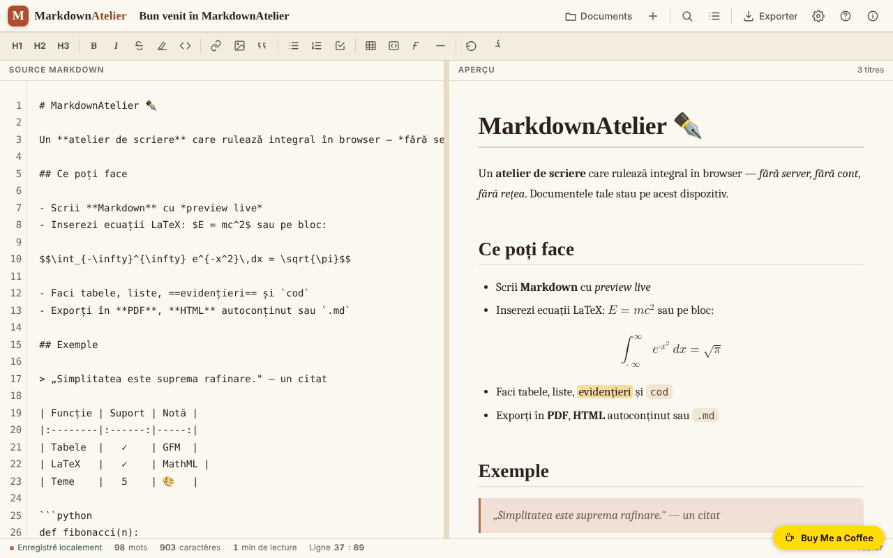

# MarkdownAtelier

[English](README.md) · [Română](README.ro.md) · **Français** · [Italiano](README.it.md) · [Español](README.es.md) · [Português](README.pt.md) · [Deutsch](README.de.md) · [Magyar](README.hu.md)

**Version :** 1.2.0 · **Dernière mise à jour :** 2026-10-19

Langues de l'interface : **Română, English, Français, Italiano, Español, Português (PT), Deutsch, Magyar**

Atelier d'écriture Markdown avec aperçu, export et documents enregistrés localement.

**En ligne :** https://chiuta.github.io/MarkdownAtelier/

## De quoi s'agit-il

MarkdownAtelier est un éditeur Markdown dans un seul fichier HTML, avec aperçu côte à côte, gestionnaire de documents, recherche/remplacement et export en .md, .html et PDF (via l'impression). Vos documents restent dans votre navigateur.

## Fonctionnalités

- Éditeur (« Editor ») et aperçu (« Preview »), avec défilement synchronisé optionnel et « Mode focus ».
- Barre de mise en forme (H1, H2, H3, B, I etc.), compteur de mots, de caractères et de minutes de lecture, indicateur « Ligne : colonne ».
- Syntaxe : titres, gras, italique, barré, ==surligné==, code en ligne, ~indice~, ^exposant^, listes et listes de tâches, citations, tableaux GFM, notes de bas de page, blocs de code avec langage, équations `$en ligne$` et `$$bloc$$` (LaTeX converti en MathML natif), table des matières automatique `[[toc]]`, détails repliables `::: details`.
- Réglages : thème, langue de l'interface (English, Română, Français, Italiano, Español, Português, Deutsch, Magyar), retour à la ligne, numéros de ligne, numérotation automatique des titres dans la table des matières, typographie intelligente, codes emoji (`:rocket:` devient 🚀), taille du texte.
- Documents : « Importer .md », « ＋ Nouveau document », liste de documents avec recherche (dans les titres et le texte), « Backup .json » (tous les documents dans un fichier) et « Restaurer » (ajoute les documents d'une sauvegarde, sans écraser les existants).
- Au premier lancement, sans réglages enregistrés, l'application choisit le thème sombre « midnight » si le système le préfère.
- Export : .md, .html autonome, PDF (impression), « Copier le HTML dans le presse-papiers » ; panneau de table des matières et aide sur la syntaxe.

## Nouveautés (1.1.0)

- **Vérification locale des données personnelles avant export ou copie** (`FFF.pii`) : sur « ↓ .md », « ↓ .html », « 🖨 PDF » et « Copier le HTML » (et sur Ctrl+Maj+P), l'application recherche dans le navigateur des e-mails, téléphones, IBAN (mod 97), CNP (chiffre de contrôle), cartes (Luhn), IP, clés/jetons, adresses et noms (ces derniers avec une faible confiance). Si elle trouve quelque chose, elle n'exporte pas avant que vous choisissiez : « Masquer les éléments cochés et continuer », « Continuer sans masquer » ou « Annuler ». **Le document de l'éditeur n'est pas modifié** : seule une copie masquée est exportée. L'option peut être désactivée depuis le panneau Export (la préférence est conservée).
- **« 🛡 Vérifier le document maintenant »** (panneau Export) : analyse le document courant ; si elle trouve des données personnelles, vous pouvez créer un **nouveau document** où elles sont masquées (l'original reste intact).
- **Recherche locale par sens dans les documents** (`FFF.search` : BM25, normalisation des diacritiques, formes proches, extraits mis en évidence ; sans réseau). Elle remplace la simple correspondance de sous-chaîne, avec la même interface ; si le kit est absent, l'ancienne variante est utilisée.
- **Indicateur de confidentialité** dans le panneau « Documents » : les documents restent sur l'appareil, l'application ne fait aucune requête réseau (CSP : `default-src 'self'`, sans `connect-src` ; vérifié en test : 0 requête). L'étiquette de transparence (appuyez sur la version dans « À propos ») propose l'export/import/suppression `.fff.json` avec chiffrement optionnel par mot de passe (AES-GCM, PBKDF2).
- **Accessibilité :** les fenêtres modales ont désormais `role="dialog"`, `aria-modal` et un nom, et la notification (`#toast`) est une région `status` ; axe-core : 0 violation (avant, le panneau Export avait une violation « region »).

### Limites
- La détection des données personnelles est heuristique : elle peut en manquer ou en signaler à tort. Elle ne remplace pas votre propre vérification avant de publier un texte.
- Seul le texte Markdown est analysé, pas les images ni les fichiers joints par data-URI.
- Les traductions des nouveaux textes en fr/it/es/pt/de/hu sont automatiques et **non vérifiées par des natifs**.

**Kit FFF.** Du `fff-kit` (collé dans `index.html`, sans réseau) sont utilisés `core, label, bundle, pii, search`. La politique CSP **n'a pas été modifiée**, hormis les hashs `sha256` des scripts en ligne (le style de la boîte de dialogue des données personnelles est injecté dans `<style>`, couvert par le `style-src 'unsafe-inline'` déjà présent ; aucun nouvel hôte).

## Mode d'emploi

Raccourcis clavier (affichés dans l'application) :

- Ctrl B gras, Ctrl I italique, Ctrl K lien, Ctrl ` code en ligne
- Ctrl F rechercher / remplacer
- Ctrl S enregistrer
- Ctrl E exporter
- Ctrl O documents
- Ctrl Alt N nouveau document
- Tab indentation

Étapes :

1. Écrivez dans le panneau « Source Markdown » ; l'aperçu apparaît à côté ; les commutateurs ✍️ Editor et 👁️ Preview choisissent le panneau affiché.
2. Gérez les documents depuis « Documents » (Ctrl O) : « Importer .md » ou « ＋ Nouveau document ».
3. Exportez depuis « Export » (Ctrl E) : « ↓ .md », « ↓ .html », « 🖨 PDF » (choisissez « Enregistrer au format PDF » dans la boîte d'impression) ou « ⧉ Copier ».
4. Réglez le thème, la langue et les options dans « Réglages ».
5. Pour supprimer tout ce que l'application a enregistré, utilisez « Supprimer toutes les données » dans les Réglages.

## Confidentialité et réseau

- Les documents et les réglages sont conservés dans `localStorage` (clés `markdownatelier.v1` et `markdownatelier.settings.v1`) ; l'indicateur « Enregistré localement » montre l'état.
- La politique CSP n'autorise plus de scripts en ligne arbitraires (`script-src` par hash SHA-256, sans `'unsafe-inline'`).
- L'application ne fait aucune requête réseau (pas de `fetch`, de CDN ni de scripts externes). Elle ne contient que des liens, ouverts au clic, vers Buy Me a Coffee et chiuta.github.io.
- Les données ne sont pas synchronisées entre appareils ; pour la sauvegarde, exportez les fichiers.

## Exécution locale / hors ligne

Téléchargez `index.html` et ouvrez-le dans un navigateur ; aucune connexion Internet n'est nécessaire.

## Historique / Changelog

- **1.1.0 — 2026-10-14 :** vérification locale des données personnelles avant export/copie (`FFF.pii`), « Vérifier maintenant » avec nouveau document masqué, recherche locale par sens (`FFF.search`), indicateur de confidentialité, étiquette de transparence et sauvegarde chiffrée (`FFF.bundle`), `role="dialog"` sur les fenêtres ; tests dans `tests/fff-r8.test.mjs`.
- 1.0.0 — 2026-10-12 : la version et la date de la dernière mise à jour s'affichent dans l'application
- Tour 7 : `~indice~` fonctionne aussi au milieu des mots (H~2~O, CO~2~) ; un nouveau document reçoit automatiquement le titre du premier titre Markdown (`# ...`) tant que le titre n'a pas été modifié à la main ; meilleur contraste pour le texte ~~barré~~.
- Sur les écrans étroits (360 px), la barre supérieure et la barre d'état ne débordent plus de l'écran ; le titre du document passe sur une ligne séparée, et le bouton Réglages est visible.
- Le commutateur « Editor / Preview » apparaît désormais sur mobile (il était masqué par une règle CSS écrasée).
- Documents : recherche dans les titres/contenus, Backup .json et Restaurer (avec validation et message d'erreur) ; thème sombre par défaut au premier lancement si le système le préfère ; CSP `script-src` par hash au lieu de `'unsafe-inline'`.
- Ajout d'un titre de niveau 1 (masqué visuellement) pour les lecteurs d'écran ; vérification axe-core : 0 violation à 1280 et 360 px.

## Licence

MIT — voir le fichier LICENSE

## Auteur

Alexio — Alexandru-Ionuț Chiuță, contact : alexio@trom.tf

## Résumé

MarkdownAtelier est un éditeur Markdown en un seul fichier avec aperçu en direct, gestionnaire de documents, recherche/remplacement, équations LaTeX vers MathML, tableaux, notes de bas de page et export en .md, .html et PDF (via l'impression). Les documents sont conservés dans le localStorage du navigateur. Interface en 8 langues. Aucune requête réseau.

