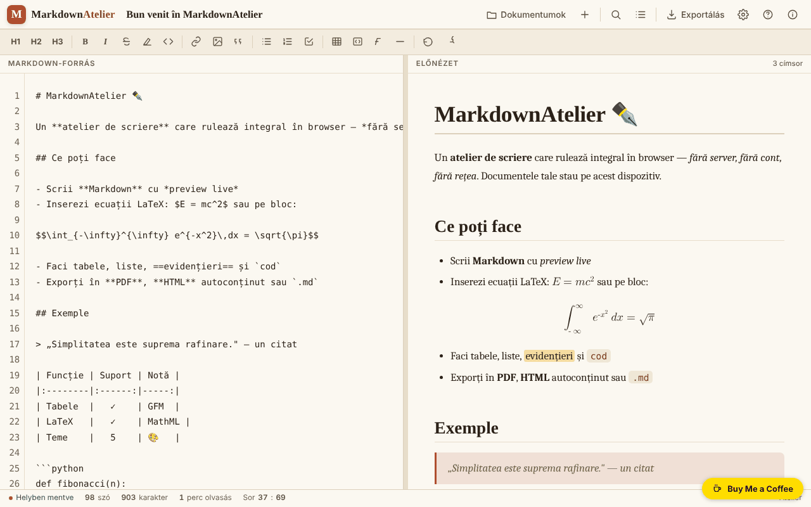

# MarkdownAtelier

[English](README.md) · [Română](README.ro.md) · [Français](README.fr.md) · [Italiano](README.it.md) · [Español](README.es.md) · [Português](README.pt.md) · [Deutsch](README.de.md) · **Magyar**

**Verzió:** 1.2.3 · **Utolsó frissítés:** 2026-10-22

A felület nyelvei: **Română, English, Français, Italiano, Español, Português (PT), Deutsch, Magyar**

Markdown-író műhely előnézettel, exporttal és helyben mentett dokumentumokkal.

**Élő változat:** https://chiuta.github.io/MarkdownAtelier/

## Mi ez

A MarkdownAtelier egyetlen HTML-fájlból álló Markdown-szerkesztő, egymás melletti előnézettel, dokumentumkezelővel, keresés/csere funkcióval, valamint .md, .html és PDF (nyomtatáson keresztül) exporttal. A dokumentumok az Ön böngészőjében maradnak.

## Funkciók

- Szerkesztő („Editor”) és előnézet („Preview”), opcionális szinkronizált görgetéssel és „Fókusz móddal”.
- Formázósáv (H1, H2, H3, B, I stb.), szó-, karakter- és olvasási perc számláló, „Sor : oszlop” jelző.
- Szintaxis: címsorok, félkövér, dőlt, áthúzott, ==kiemelt==, soron belüli kód, ~alsó index~, ^felső index^, listák és ellenőrzőlisták, idézetek, GFM-táblázatok, lábjegyzetek, nyelvmegjelöléses kódblokkok, `$soron belüli$` és `$$blokk$$` egyenletek (a LaTeX natív MathML-lé alakítva), automatikus tartalomjegyzék `[[toc]]`, összecsukható részletek `::: details`.
- Beállítások: téma, a felület nyelve (English, Română, Français, Italiano, Español, Português, Deutsch, Magyar), sortörés, sorszámok, a címsorok automatikus számozása a tartalomjegyzékben, intelligens tipográfia, emoji-kódok (a `:rocket:` 🚀 lesz), szövegméret.
- Dokumentumok: „.md importálása”, „＋ Új dokumentum”, dokumentumlista kereséssel (a címekben és a szövegben), „Backup .json” (az összes dokumentum egy fájlban) és „Visszaállítás” (hozzáadja a mentésben lévő dokumentumokat, a meglévőket nem írja felül).
- Első futtatáskor, mentett beállítások nélkül, az alkalmazás a „midnight” sötét témát választja, ha a rendszer azt részesíti előnyben.
- Export: .md, önálló .html, PDF (nyomtatás), „HTML másolása a vágólapra”; tartalomjegyzék-panel és szintaxissúgó.

## Újdonságok (1.1.0)

- **Személyes adatok helyi ellenőrzése export vagy másolás előtt** (`FFF.pii`): a „↓ .md”, „↓ .html”, „🖨 PDF” és „HTML másolása” műveleteknél (valamint Ctrl+Shift+P-nél) az alkalmazás a böngészőben e-mail-címeket, telefonszámokat, IBAN-t (mod 97), CNP-t (ellenőrző számjegy), kártyákat (Luhn), IP-címeket, kulcsokat/tokeneket, címeket és neveket keres (az utóbbiakat alacsony megbízhatósággal). Ha talál valamit, nem exportál, amíg nem dönt: „A bejelöltek maszkolása és folytatás”, „Folytatás maszkolás nélkül” vagy „Mégse”. **A szerkesztőben lévő dokumentum nem módosul**: csak egy maszkolt másolat kerül exportálásra. A beállítás az Export panelen kikapcsolható (a preferencia megmarad).
- **„🛡 Dokumentum ellenőrzése most”** (Export panel): átvizsgálja az aktuális dokumentumot; ha személyes adatot talál, létrehozhat egy **új dokumentumot** maszkolt adatokkal (az eredeti érintetlen marad).
- **Helyi jelentés szerinti keresés a dokumentumokban** (`FFF.search`: BM25, ékezetek normalizálása, közeli alakok, kiemelt részletek; hálózat nélkül). Az egyszerű részlánc-egyezést váltja fel, ugyanazzal a felülettel; ha a kit hiányzik, a régi változat használatos.
- **Adatvédelmi jelző** a „Dokumentumok” panelen: a dokumentumok az eszközön maradnak, az alkalmazás nem végez hálózati kéréseket (CSP: `default-src 'self'`, `connect-src` nélkül; tesztben ellenőrizve: 0 kérés). Az átláthatósági címke (nyomja meg a verziót a „Névjegy” alatt) `.fff.json` exportot/importot/törlést kínál opcionális jelszavas titkosítással (AES-GCM, PBKDF2).
- **Akadálymentesség:** a modális ablakok mostantól `role="dialog"`, `aria-modal` attribútumot és nevet kaptak, az értesítés (`#toast`) pedig `status` régió; axe-core: 0 szabálysértés (korábban az Export panelen egy „region” szabálysértés volt).

### 1.2.2 — 2026-10-22
- Az eszköztár és a keresés súgószövegei, a hozzáférhetőségi feliratok, a szerkesztő helyőrzője, a szintaxissúgó, a kódblokk-gombok, valamint az oldal címe és leírása minden nyelven le van fordítva; a módosítatlan üdvözlő dokumentum követi a felület nyelvét.

### Korlátok
- A személyes adatok felismerése heurisztikus: kihagyhat vagy tévesen jelezhet. Nem helyettesíti az Ön saját ellenőrzését a szöveg közzététele előtt.
- Csak a Markdown-szöveg kerül átvizsgálásra, a képek és a data-URI-val csatolt fájlok nem.
- Az új szövegek fr/it/es/pt/de/hu fordításai automatikusak, és **anyanyelvi ellenőrzés nélküliek**.

**FFF kit.** Az `fff-kit` (az `index.html`-be illesztve, hálózat nélkül) `core, label, bundle, pii, search` moduljai használatosak. A CSP-szabályzat **nem változott**, kivéve a beágyazott szkriptek `sha256` hashét (a személyes adatok párbeszédablakának stílusa a `<style>` elembe kerül, amelyet a már meglévő `style-src 'unsafe-inline'` lefed; új gazdagép nincs).

## Használati útmutató

Billentyűparancsok (az alkalmazásban megjelenítve):

- Ctrl B félkövér, Ctrl I dőlt, Ctrl K hivatkozás, Ctrl ` soron belüli kód
- Ctrl F keresés / csere
- Ctrl S mentés
- Ctrl E export
- Ctrl O dokumentumok
- Ctrl Alt N új dokumentum
- Tab behúzás

Lépések:

1. Írjon a „Markdown forrás” panelben; az előnézet mellette jelenik meg; a ✍️ Editor és 👁️ Preview kapcsolók választják ki a megjelenített panelt.
2. Kezelje a dokumentumokat a „Dokumentumok” panelen (Ctrl O): „.md importálása” vagy „＋ Új dokumentum”.
3. Exportáljon az „Export” panelről (Ctrl E): „↓ .md”, „↓ .html”, „🖨 PDF” (a nyomtatási ablakban válassza a „Mentés PDF-ként” lehetőséget) vagy „⧉ Másolás”.
4. Állítsa be a témát, a nyelvet és a beállításokat a „Beállítások” alatt.
5. Az alkalmazás által mentett összes adat törléséhez használja a Beállítások „Minden adat törlése” gombját.

## Adatvédelem és hálózat

- A dokumentumok és a beállítások a `localStorage`-ban tárolódnak (`markdownatelier.v1` és `markdownatelier.settings.v1` kulcsok); a „Helyben mentve” jelző mutatja az állapotot.
- A CSP-szabályzat már nem engedélyez tetszőleges beágyazott szkripteket (`script-src` SHA-256 hash alapján, `'unsafe-inline'` nélkül).
- Az alkalmazás nem végez hálózati kéréseket (nincs `fetch`, CDN vagy külső szkript). Csak kattintásra megnyíló hivatkozásokat tartalmaz a Buy Me a Coffee és a chiuta.github.io felé.
- Az adatok nem szinkronizálódnak az eszközök között; biztonsági mentéshez exportálja a fájlokat.

## Helyi / offline futtatás

Töltse le az `index.html` fájlt, és nyissa meg böngészőben; internet nem szükséges.

## Előzmények / Changelog

- **1.2.3 — 2026-10-22:** a keresősáv „Csere” és „Mind” gombjai, valamint a nyelvválasztó hozzáférhetőségi címkéje mostantól minden nyelven le van fordítva (nincs több román maradvány).
- **1.1.0 — 2026-10-14:** személyes adatok helyi ellenőrzése export/másolás előtt (`FFF.pii`), „Ellenőrzés most” új, maszkolt dokumentummal, helyi jelentés szerinti keresés (`FFF.search`), adatvédelmi jelző, átláthatósági címke és titkosított mentés (`FFF.bundle`), `role="dialog"` az ablakokon; tesztek a `tests/fff-r8.test.mjs` fájlban.
- 1.0.0 — 2026-10-12: a verzió és az utolsó frissítés dátuma megjelenik az alkalmazásban
- 7. kör: az `~alsó index~` szavak közepén is működik (H~2~O, CO~2~); az új dokumentum automatikusan megkapja az első Markdown-címsor (`# ...`) címét, amíg a címet kézzel nem szerkesztették; jobb kontraszt az ~~áthúzott~~ szövegnél.
- Keskeny képernyőkön (360 px) a felső sáv és az állapotsáv már nem lóg túl a képernyőn; a dokumentum címe külön sorba kerül, és a Beállítások gomb látható.
- Az „Editor / Preview” kapcsoló mostantól mobilon is megjelenik (egy felülírt CSS-szabály elrejtette).
- Dokumentumok: keresés a címekben/tartalomban, Backup .json és Visszaállítás (érvényesítéssel és hibaüzenettel); alapértelmezett sötét téma első futtatáskor, ha a rendszer azt részesíti előnyben; CSP `script-src` hash alapján `'unsafe-inline'` helyett.
- Egyes szintű címsor (vizuálisan rejtett) hozzáadva a képernyőolvasók számára; axe-core ellenőrzés: 0 szabálysértés 1280 és 360 px-en.

## Licenc

MIT — lásd a LICENSE fájlt

## Szerző

Alexio — Alexandru-Ionuț Chiuță, kapcsolat: alexio@trom.tf

## Összefoglaló
A MarkdownAtelier egyfájlos Markdown-szerkesztő élő előnézettel, dokumentumkezelővel, keresés/csere funkcióval, LaTeX–MathML egyenletekkel, táblázatokkal, lábjegyzetekkel, valamint .md, .html és PDF (nyomtatáson keresztül) exporttal. A dokumentumok a böngésző localStorage-ában tárolódnak. 8 felületi nyelv. Nincsenek hálózati kérések.
