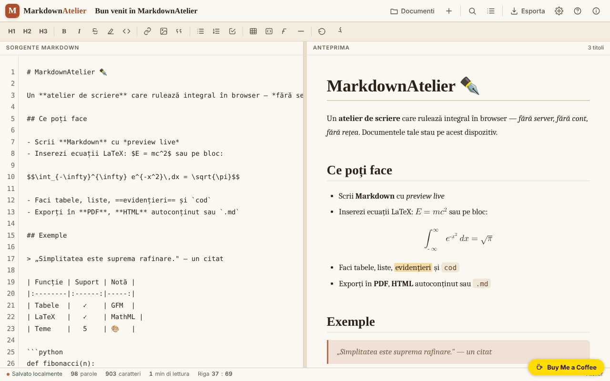

# MarkdownAtelier

[English](README.md) · [Română](README.ro.md) · [Français](README.fr.md) · **Italiano** · [Español](README.es.md) · [Português](README.pt.md) · [Deutsch](README.de.md) · [Magyar](README.hu.md)

**Versione:** 1.2.6 · **Ultimo aggiornamento:** 2026-10-22

Lingue dell'interfaccia: **Română, English, Français, Italiano, Español, Português (PT), Deutsch, Magyar**

Laboratorio di scrittura Markdown con anteprima, esportazione e documenti salvati localmente.

**Online:** https://chiuta.github.io/MarkdownAtelier/

## Cos'è

MarkdownAtelier è un editor Markdown in un unico file HTML, con anteprima affiancata, gestore di documenti, ricerca/sostituzione ed esportazione in .md, .html e PDF (tramite stampa). I documenti restano nel tuo browser.

## Funzioni

- Editor («Editor») e anteprima («Preview»), con scorrimento sincronizzato opzionale e «Modalità focus».
- Barra di formattazione (H1, H2, H3, B, I ecc.), contatore di parole, caratteri e minuti di lettura, indicatore «Riga : colonna».
- Sintassi: titoli, grassetto, corsivo, barrato, ==evidenziato==, codice inline, ~pedice~, ^apice^, elenchi e checklist, citazioni, tabelle GFM, note a piè di pagina, blocchi di codice con linguaggio, equazioni `$inline$` e `$$blocco$$` (LaTeX convertito in MathML nativo), indice automatico `[[toc]]`, dettagli comprimibili `::: details`.
- Impostazioni: tema, lingua dell'interfaccia (English, Română, Français, Italiano, Español, Português, Deutsch, Magyar), a capo automatico, numeri di riga, numerazione automatica dei titoli nell'indice, tipografia intelligente, codici emoji (`:rocket:` diventa 🚀), dimensione del testo.
- Documenti: «Importa .md», «＋ Nuovo documento», elenco di documenti con ricerca (nei titoli e nel testo), «Backup .json» (tutti i documenti in un file) e «Ripristina» (aggiunge i documenti da un backup, senza sovrascrivere quelli esistenti).
- Alla prima esecuzione, senza impostazioni salvate, l'applicazione sceglie il tema scuro «midnight» se il sistema lo preferisce.
- Esportazione: .md, .html autonomo, PDF (stampa), «Copia HTML negli appunti»; pannello dell'indice e aiuto sulla sintassi.

## Novità (1.1.0)

- **Verifica locale dei dati personali prima dell'esportazione o della copia** (`FFF.pii`): su «↓ .md», «↓ .html», «🖨 PDF» e «Copia HTML» (e su Ctrl+Maiusc+P), l'applicazione cerca nel browser e-mail, telefoni, IBAN (mod 97), CNP (cifra di controllo), carte (Luhn), IP, chiavi/token, indirizzi e nomi (questi ultimi con bassa affidabilità). Se trova qualcosa, non esporta finché non scegli: «Maschera i selezionati e continua», «Continua senza mascherare» o «Annulla». **Il documento nell'editor non viene modificato**: viene esportata solo una copia mascherata. L'opzione può essere disattivata dal pannello Esporta (la preferenza viene conservata).
- **«🛡 Verifica ora il documento»** (pannello Esporta): analizza il documento corrente; se trova dati personali, puoi creare un **nuovo documento** con i dati mascherati (l'originale resta intatto).
- **Ricerca locale per significato nei documenti** (`FFF.search`: BM25, normalizzazione dei segni diacritici, forme vicine, frammenti evidenziati; senza rete). Sostituisce la semplice corrispondenza di sottostringa, con la stessa interfaccia; se il kit manca, si usa la vecchia variante.
- **Indicatore di privacy** nel pannello «Documenti»: i documenti restano sul dispositivo, l'applicazione non effettua richieste di rete (CSP: `default-src 'self'`, senza `connect-src`; verificato nei test: 0 richieste). L'etichetta di trasparenza (premi la versione in «Informazioni») offre esportazione/importazione/eliminazione `.fff.json` con cifratura opzionale con password (AES-GCM, PBKDF2).
- **Accessibilità:** le finestre modali hanno ora `role="dialog"`, `aria-modal` e un nome, e la notifica (`#toast`) è una regione `status`; axe-core: 0 violazioni (prima il pannello Esporta aveva una violazione «region»).

### 1.2.2 — 2026-10-22
- I suggerimenti della barra degli strumenti e della ricerca, le etichette di accessibilità, il segnaposto dell'editor, la guida alla sintassi, i pulsanti dei blocchi di codice e il titolo/la descrizione della pagina sono tradotti in tutte le lingue; il documento di benvenuto non modificato segue la lingua dell'interfaccia.

### Limiti
- Il rilevamento dei dati personali è euristico: può non vedere o segnalare erroneamente. Non sostituisce la tua verifica prima di pubblicare un testo.
- Viene analizzato solo il testo Markdown, non le immagini né i file allegati tramite data-URI.
- Le traduzioni dei nuovi testi in fr/it/es/pt/de/hu sono automatiche e **non verificate da madrelingua**.

**Kit FFF.** Dal `fff-kit` (incollato in `index.html`, senza rete) si usano `core, label, bundle, pii, search`. La politica CSP **non è stata modificata** a parte gli hash `sha256` degli script inline (lo stile della finestra dei dati personali è iniettato in `<style>`, coperto dallo `style-src 'unsafe-inline'` già presente; nessun nuovo host).

## Guida all'uso

Scorciatoie da tastiera (mostrate nell'applicazione):

- Ctrl B grassetto, Ctrl I corsivo, Ctrl K link, Ctrl ` codice inline
- Ctrl F cerca / sostituisci
- Ctrl S salva
- Ctrl E esporta
- Ctrl O documenti
- Ctrl Alt N nuovo documento
- Tab rientro

Passi:

1. Scrivi nel pannello «Sorgente Markdown»; l'anteprima compare accanto; gli interruttori ✍️ Editor e 👁️ Preview scelgono il pannello mostrato.
2. Gestisci i documenti da «Documenti» (Ctrl O): «Importa .md» o «＋ Nuovo documento».
3. Esporta da «Esporta» (Ctrl E): «↓ .md», «↓ .html», «🖨 PDF» (nella finestra di stampa scegli «Salva come PDF») o «⧉ Copia».
4. Regola tema, lingua e opzioni da «Impostazioni».
5. Per eliminare tutto ciò che l'applicazione ha salvato, usa «Elimina tutti i dati» nelle Impostazioni.

## Privacy e rete

- I documenti e le impostazioni sono conservati in `localStorage` (chiavi `markdownatelier.v1` e `markdownatelier.settings.v1`); l'indicatore «Salvato localmente» mostra lo stato.
- La politica CSP non consente più script inline arbitrari (`script-src` tramite hash SHA-256, senza `'unsafe-inline'`).
- L'applicazione non effettua richieste di rete (nessun `fetch`, CDN o script esterni). Contiene solo link, aperti al clic, verso Buy Me a Coffee e chiuta.github.io.
- I dati non si sincronizzano tra dispositivi; per il backup esporta i file.

## Esecuzione locale / offline

Scarica `index.html` e aprilo in un browser; non richiede Internet.

## Storico / Changelog

### 1.2.6 — 2026-10-22

fff-kit 1.1.4: aree tattili e testo minimo. Aree tattili/testo corretti nell’app.

### 1.2.5 — 2026-10-22

fff-kit 1.1.2: PBKDF2 a 600.000 iterazioni, protezione anti-clickjacking.

### 1.2.4 — 2026-10-22
- Un solo H1 per pagina: un «# Titolo» del documento appare nell'anteprima come H2 con lo stesso aspetto.
- Su schermi stretti la barra di formattazione va a capo invece di essere tagliata di lato; i pulsanti sono più grandi (36 px).
- I confirm() nativi (elimina documento, cancella tutto) sono stati sostituiti da una finestra accessibile e tradotta.
- Mobile: nessun testo sotto i 12 px e aree tattili di almeno 24 px (WCAG 2.5.8).

- **1.2.3 — 2026-10-22:** i pulsanti «Sostituisci» e «Tutti» della barra di ricerca e l'etichetta di accessibilità del selettore di lingua sono ora tradotti in tutte le lingue (nessun residuo in rumeno).
- **1.1.0 — 2026-10-14:** verifica locale dei dati personali prima di esportazione/copia (`FFF.pii`), «Verifica ora» con nuovo documento mascherato, ricerca locale per significato (`FFF.search`), indicatore di privacy, etichetta di trasparenza e copia cifrata (`FFF.bundle`), `role="dialog"` sulle finestre; test in `tests/fff-r8.test.mjs`.
- 1.0.0 — 2026-10-12: la versione e la data dell'ultimo aggiornamento sono mostrate nell'applicazione
- Round 7: `~pedice~` funziona anche in mezzo alle parole (H~2~O, CO~2~); un nuovo documento riceve automaticamente il titolo del primo titolo Markdown (`# ...`) finché il titolo non è stato modificato a mano; contrasto migliore per il testo ~~barrato~~.
- Sugli schermi stretti (360 px) la barra superiore e la barra di stato non escono più dallo schermo; il titolo del documento passa su una riga separata e il pulsante Impostazioni è visibile.
- L'interruttore «Editor / Preview» compare ora su mobile (era nascosto da una regola CSS sovrascritta).
- Documenti: ricerca nei titoli/contenuti, Backup .json e Ripristina (con validazione e messaggio di errore); tema scuro predefinito alla prima esecuzione se il sistema lo preferisce; CSP `script-src` tramite hash al posto di `'unsafe-inline'`.
- Aggiunto un titolo di livello 1 (nascosto visivamente) per gli screen reader; verifica axe-core: 0 violazioni a 1280 e 360 px.

## Licenza

MIT — vedi il file LICENSE

## Autore

Alexio — Alexandru-Ionuț Chiuță, contatto: alexio@trom.tf

## Riepilogo

MarkdownAtelier è un editor Markdown in un unico file con anteprima in tempo reale, gestore di documenti, trova/sostituisci, equazioni da LaTeX a MathML, tabelle, note a piè di pagina ed esportazione in .md, .html e PDF (tramite stampa). I documenti sono conservati nel localStorage del browser. 8 lingue dell'interfaccia. Nessuna richiesta di rete.
