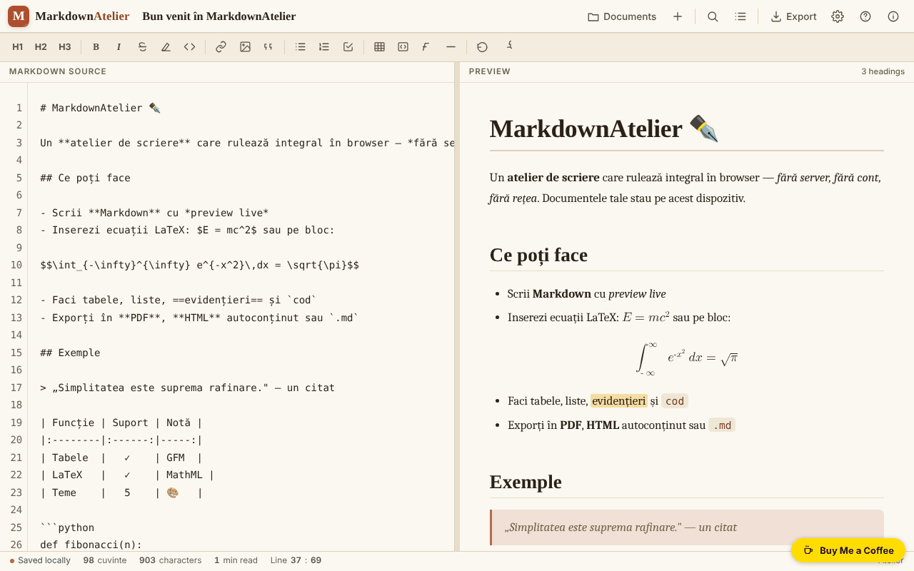

# MarkdownAtelier

**English** · [Română](README.ro.md) · [Français](README.fr.md) · [Italiano](README.it.md) · [Español](README.es.md) · [Português](README.pt.md) · [Deutsch](README.de.md) · [Magyar](README.hu.md)

**Version:** 1.2.9 · **Last updated:** 2026-10-23

Interface languages: **Română, English, Français, Italiano, Español, Português (PT), Deutsch, Magyar**

A Markdown writing workshop with preview, export and locally saved documents.

**Live:** https://chiuta.github.io/MarkdownAtelier/

## What it is

MarkdownAtelier is a Markdown editor in a single HTML file, with side-by-side preview, a document manager, search/replace and export to .md, .html and PDF (via print). Your documents stay in your browser.

## Features

- Editor ("Editor") and preview ("Preview"), with optional synchronized scrolling and "Focus mode".
- Formatting bar (H1, H2, H3, B, I etc.), word, character and reading-minute counter, "Line : column" indicator.
- Syntax: headings, bold, italic, strikethrough, ==highlight==, inline code, ~sub~, ^sup^, lists and checklists, quotes, GFM tables, footnotes, code blocks with language, equations `$inline$` and `$$block$$` (LaTeX converted to native MathML), automatic table of contents `[[toc]]`, collapsible details `::: details`.
- Settings: theme, interface language (English, Română, Français, Italiano, Español, Português, Deutsch, Magyar), word wrap, line numbers, auto-numbering of headings in the table of contents, smart typography, emoji codes (`:rocket:` becomes 🚀), text size.
- Documents: "Import .md", "＋ New document", a document list with search (in titles and text), "Backup .json" (all documents in one file) and "Restore" (adds the documents from a backup, without overwriting the existing ones).
- On first run, with no saved settings, the application chooses the dark "midnight" theme if the system prefers it.
- Export: .md, self-contained .html, PDF (print), "Copy HTML to clipboard"; table-of-contents panel and syntax help.

## New features (1.1.0)

- **Local check for personal data before export or copy** (`FFF.pii`): on "↓ .md", "↓ .html", "🖨 PDF" and "Copy HTML" (and on Ctrl+Shift+P), the application searches in the browser for e-mails, phone numbers, IBANs (mod 97), CNPs (check digit), cards (Luhn), IPs, keys/tokens, addresses and names (the latter with low confidence). If it finds anything, it does not export until you choose: "Mask the checked ones and continue", "Continue without masking" or "Cancel". **The document in the editor is not modified**: only a masked copy is exported. The option can be turned off from the Export panel (the preference is kept).
- **"🛡 Check the document now"** (Export panel): scans the current document; if it finds personal data, you can create a **new document** with it masked (the original stays untouched).
- **Local meaning-based search across documents** (`FFF.search`: BM25, diacritics normalization, close forms, highlighted snippets; no network). It replaces the simple substring match, with the same interface; if the kit is missing, the old variant is used.
- **Privacy indicator** in the "Documents" panel: the documents stay on the device, the application makes no network requests (CSP: `default-src 'self'`, no `connect-src`; verified in tests: 0 requests). The transparency label (press the version in "About") offers `.fff.json` export/import/deletion with optional password encryption (AES-GCM, PBKDF2).
- **Accessibility:** the modal windows now have `role="dialog"`, `aria-modal` and a name, and the notification (`#toast`) is a `status` region; axe-core: 0 violations (before, the Export panel had one "region" violation).

### 1.2.2 — 2026-10-22
- Toolbar and search tooltips, accessibility labels, editor placeholder, syntax help, code-block buttons and the page title/description are now translated into all languages; the unmodified welcome document follows the interface language.

### Limits
- Personal-data detection is heuristic: it may miss or wrongly flag items. It does not replace your own check before publishing a text.
- Only the Markdown text is scanned, not images or files attached via data-URI.
- The translations of the new texts in fr/it/es/pt/de/hu are automatic and **not natively verified**.

**FFF kit.** From `fff-kit` (pasted into `index.html`, no network) the modules `core, label, bundle, pii, search` are used. The CSP policy has **not been changed** apart from the `sha256` hashes of the inline scripts (the style of the personal-data dialog is injected into `<style>`, covered by the `style-src 'unsafe-inline'` already present; no new host).

## User guide

Keyboard shortcuts (shown in the application):

- Ctrl B bold, Ctrl I italic, Ctrl K link, Ctrl ` inline code
- Ctrl F find / replace
- Ctrl S save
- Ctrl E export
- Ctrl O documents
- Ctrl Alt N new document
- Tab indent

Steps:

1. Write in the "Markdown source" panel; the preview appears alongside; the ✍️ Editor and 👁️ Preview toggles choose the displayed panel.
2. Manage documents from "Documents" (Ctrl O): "Import .md" or "＋ New document".
3. Export from "Export" (Ctrl E): "↓ .md", "↓ .html", "🖨 PDF" (choose "Save as PDF" in the print dialog) or "⧉ Copy".
4. Adjust the theme, language and options in "Settings".
5. To delete everything the application has saved, use "Delete all data" in Settings.

## Privacy and network

- Documents and settings are kept in `localStorage` (keys `markdownatelier.v1` and `markdownatelier.settings.v1`); the "Saved locally" indicator shows the status.
- The CSP policy no longer allows arbitrary inline scripts (`script-src` by SHA-256 hash, no `'unsafe-inline'`).
- The application makes no network requests (no `fetch`, CDN or external scripts). It contains only links, opened on click, to Buy Me a Coffee and chiuta.github.io.
- Data is not synchronized between devices; for backup, export the files.

## Local / offline use

Download `index.html` and open it in a browser; no internet required.

## History / Changelog

### 1.2.9 — 2026-10-23

- Markdown: the URL of a link (`[a](https://site/_x_/y)`) was mangled by the emphasis rules (`_ * ~ ^ ==` became `<em>`/``/`<mark>` inside `href`); the opening tags of links and images are now protected. No XSS was found.

### 1.2.8 — 2026-10-23

- fff-kit 1.2.0 audit: the i18n-parity warning is a false positive (the keys are completed at run time); documented as a justified exception in `fff.config.json`. No functional change.

### 1.2.6 — 2026-10-22

fff-kit 1.1.4: touch targets and minimum text size. Touch targets/text fixed in the app.

### 1.2.5 — 2026-10-22

fff-kit 1.1.2: PBKDF2 with 600,000 iterations, anti-clickjacking protection.

### 1.2.4 — 2026-10-22
- A single H1 per page: a "# Title" in the document is shown in the preview as an H2 with the same look.
- On narrow screens the formatting toolbar wraps instead of being clipped sideways; its buttons are larger (36 px).
- The native confirm() dialogs (delete a document, erase everything) were replaced by a translated accessible dialog.
- Mobile: no text below 12 px and touch targets of at least 24 px (WCAG 2.5.8).

- **1.2.3 — 2026-10-22:** the "Replace" and "All" buttons of the search bar and the language selector's accessibility label are now translated into all languages (no more Romanian leftovers).
- **1.1.0 — 2026-10-14:** local check for personal data before export/copy (`FFF.pii`), "Check now" with a new masked document, local meaning-based search (`FFF.search`), privacy indicator, transparency label and encrypted backup (`FFF.bundle`), `role="dialog"` on windows; tests in `tests/fff-r8.test.mjs`.
- 1.0.0 — 2026-10-12: the version and the date of the last update are shown in the application
- Round 7: `~sub~` also works in the middle of words (H~2~O, CO~2~); a new document automatically gets the title of the first Markdown heading (`# ...`) as long as the title has not been edited manually; better contrast for ~~strikethrough~~ text.
- On narrow screens (360 px) the top bar and the status bar no longer overflow the screen; the document title moves to a separate row, and the Settings button is visible.
- The "Editor / Preview" toggle now appears on mobile (it was hidden by an overridden CSS rule).
- Documents: search in titles/content, Backup .json and Restore (with validation and an error message); dark theme by default on first run if the system prefers it; CSP `script-src` by hash instead of `'unsafe-inline'`.
- Added a level-1 heading (visually hidden) for screen readers; axe-core check: 0 violations at 1280 and 360 px.

## License

MIT — see the LICENSE file

## Author

Alexio — Alexandru-Ionuț Chiuță, contact: alexio@trom.tf

## English summary

MarkdownAtelier is a single-file Markdown editor with live preview, document manager, find/replace, LaTeX-to-MathML equations, tables, footnotes and export to .md, .html and PDF (via print). Documents are kept in the browser's localStorage. 8 UI languages. No network requests.
