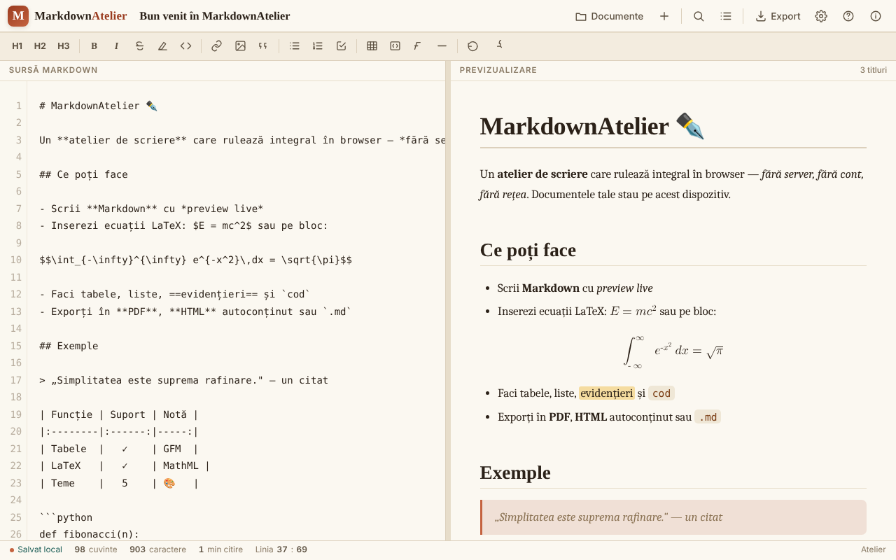

# MarkdownAtelier

**Versiune:** 1.1.0 · **Ultima actualizare:** 14 octombrie 2026

Atelier de scriere Markdown cu previzualizare, export și documente salvate local.

**Live:** https://chiuta.github.io/MarkdownAtelier/

## Ce este

MarkdownAtelier este un editor Markdown dintr-un singur fișier HTML, cu previzualizare în paralel, gestionar de documente, căutare/înlocuire și export în .md, .html și PDF (prin tipărire). Documentele rămân în browserul tău.

## Funcții

- Editor („Editor") și previzualizare („Preview"), cu scroll sincronizat opțional și „Mod focus".
- Bară de formatare (H1, H2, H3, B, I etc.), contor de cuvinte, caractere și minute de citire, indicator „Linia : coloana".
- Sintaxă: titluri, bold, italic, tăiat, ==evidențiat==, cod inline, ~sub~, ^sup^, liste și checklist, citate, tabele GFM, note de subsol, blocuri de cod cu limbaj, ecuații `$inline$` și `$$bloc$$` (LaTeX convertit în MathML nativ), cuprins automat `[[toc]]`, detalii pliabile `::: details`.
- Setări: temă, limba interfeței (English, Română, Français, Italiano, Español, Português, Deutsch), word wrap, numere de linie, auto-numerotare titluri în cuprins, tipografie inteligentă, coduri emoji (`:rocket:` devine 🚀), dimensiunea textului.
- Documente: „Importă .md", „＋ Document nou", listă de documente cu căutare (în titluri și text), „Backup .json" (toate documentele într-un fișier) și „Restaurează" (adaugă documentele dintr-un backup, fără a le suprascrie pe cele existente).
- La prima rulare, fără setări salvate, aplicația alege tema întunecată „midnight" dacă sistemul o preferă.
- Export: .md, .html autoconținut, PDF (print), „Copiază HTML în clipboard"; panou de cuprins și ajutor cu sintaxa.

## Funcții noi (1.1.0)

- **Verificare locală de date personale înainte de export sau copiere** (`FFF.pii`): la „↓ .md”, „↓ .html”, „🖨 PDF” și „Copiază HTML” (și la Ctrl+Shift+P), aplicația caută în browser e-mailuri, telefoane, IBAN (mod 97), CNP (cifră de control), carduri (Luhn), IP, chei/token-uri, adrese și nume (ultimele cu încredere scăzută). Dacă găsește ceva, nu exportă până alegi: „Maschează bifatele și continuă”, „Continuă fără mascare” sau „Anulează”. **Documentul din editor nu este modificat**: se exportă doar o copie mascată. Opțiunea se poate opri din panoul Export (preferința se păstrează).
- **„🛡 Verifică acum documentul”** (panoul Export): scanează documentul curent; dacă găsește date personale, poți crea un **document nou** cu ele mascate (originalul rămâne neatins).
- **Căutare locală după sens în documente** (`FFF.search`: BM25, normalizare de diacritice, forme apropiate, fragmente evidențiate; fără rețea). Înlocuiește potrivirea simplă de subșir, cu aceeași interfață; dacă kitul lipsește, se folosește varianta veche.
- **Indicator de confidențialitate** în panoul „Documente”: documentele rămân pe dispozitiv, aplicația nu face cereri de rețea (CSP: `default-src 'self'`, fără `connect-src`; verificat în test: 0 cereri). Eticheta de transparență (apasă versiunea din „Despre”) oferă export/import/ștergere `.fff.json` cu criptare opțională cu parolă (AES-GCM, PBKDF2).
- **Accesibilitate:** ferestrele modale au acum `role="dialog"`, `aria-modal` și nume, iar notificarea (`#toast`) este regiune `status`; axe-core: 0 violări (înainte, panoul Export avea o violare „region”).

### Limite
- Detecția de date personale este euristică: poate rata sau semnala greșit. Nu înlocuiește verificarea ta înainte de a publica un text.
- Se scanează doar textul Markdown, nu imaginile sau fișierele atașate prin data-URI.
- Traducerile textelor noi în fr/it/es/pt/de sunt automate și **neverificate nativ**; aplicația nu are interfață în maghiară, deci nu există text hu.

**Kit FFF.** Din `fff-kit` (lipit în `index.html`, fără rețea) se folosesc `core, label, bundle, pii, search`. Politica CSP **nu a fost schimbată** în afară de hash-urile `sha256` ale scripturilor inline (stilul dialogului de date personale este injectat în `<style>`, acoperit de `style-src 'unsafe-inline'` deja prezent; nicio gazdă nouă).

## Manual de utilizare

Scurtături de tastatură (afișate în aplicație):

- Ctrl B îngroșat, Ctrl I italic, Ctrl K link, Ctrl ` cod inline
- Ctrl F caută / înlocuiește
- Ctrl S salvează
- Ctrl E export
- Ctrl O documente
- Ctrl Alt N document nou
- Tab indentare

Pași:

1. Scrie în panoul „Sursă Markdown"; previzualizarea apare alături; comutatoarele ✍️ Editor și 👁️ Preview aleg panoul afișat.
2. Gestionează documentele din „Documente" (Ctrl O): „Importă .md" sau „＋ Document nou".
3. Exportă din „Export" (Ctrl E): „↓ .md", „↓ .html", „🖨 PDF" (se alege „Salvează ca PDF" în dialogul de tipărire) sau „⧉ Copiază".
4. Ajustează tema, limba și opțiunile din „Setări".
5. Pentru a șterge tot ce a salvat aplicația, folosește „Șterge toate datele" din Setări.

## Confidențialitate și rețea

- Documentele și setările se păstrează în `localStorage` (chei `markdownatelier.v1` și `markdownatelier.settings.v1`); indicatorul „Salvat local" arată starea.
- Politica CSP nu mai permite scripturi inline arbitrare (`script-src` pe hash SHA-256, fără `'unsafe-inline'`).
- Aplicația nu face cereri de rețea (fără `fetch`, CDN sau scripturi externe). Conține doar link-uri, deschise la click, către Buy Me a Coffee și chiuta.github.io.
- Datele nu se sincronizează între dispozitive; pentru backup exportă fișierele.

## Rulare locală / offline

Descarcă `index.html` și deschide-l în browser; nu necesită internet.

## Istoric / Changelog

- **1.1.0 — 2026-10-14:** verificare locală de date personale înainte de export/copiere (`FFF.pii`), „Verifică acum” cu document nou mascat, căutare locală după sens (`FFF.search`), indicator de confidențialitate, etichetă de transparență și copie criptată (`FFF.bundle`), `role="dialog"` pe ferestre; teste în `tests/fff-r8.test.mjs`.
- 1.0.0 — 2026-10-12: versiunea și data ultimei actualizări sunt afișate în aplicație
- Runda 7: `~sub~` funcționează și în mijlocul cuvintelor (H~2~O, CO~2~); un document nou primește automat titlul primului titlu Markdown (`# ...`) cât timp titlul nu a fost editat manual; contrast mai bun pentru textul ~~tăiat~~.
- Pe ecrane înguste (360 px) bara de sus și bara de stare nu mai depășesc ecranul; titlul documentului trece pe rând separat, iar butonul Setări este vizibil.
- Comutatorul „Editor / Preview" apare acum pe mobil (era ascuns de o regulă CSS suprascrisă).
- Documente: căutare în titluri/conținut, Backup .json și Restaurează (cu validare și mesaj de eroare); temă întunecată implicită la prima rulare dacă sistemul o preferă; CSP `script-src` pe hash în loc de `'unsafe-inline'`.
- Adăugat titlu de nivel 1 (ascuns vizual) pentru cititoarele de ecran; verificare axe-core: 0 violări la 1280 și 360 px.

## Licență

MIT — vezi fișierul LICENSE

## Autor

Alexio — Alexandru-Ionuț Chiuță, contact: alexio@trom.tf

## English summary

MarkdownAtelier is a single-file Markdown editor with live preview, document manager, find/replace, LaTeX-to-MathML equations, tables, footnotes and export to .md, .html and PDF (via print). Documents are kept in the browser's localStorage. 7 UI languages. No network requests.
