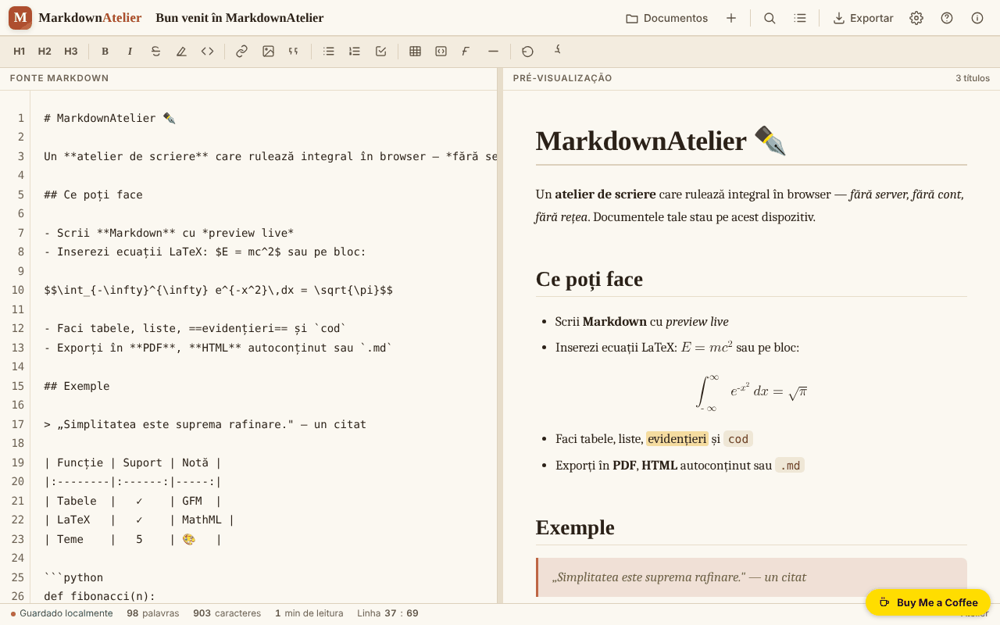

# MarkdownAtelier

[English](README.md) · [Română](README.ro.md) · [Français](README.fr.md) · [Italiano](README.it.md) · [Español](README.es.md) · **Português** · [Deutsch](README.de.md) · [Magyar](README.hu.md)

**Versão:** 1.2.1 · **Última atualização:** 2026-10-19

Idiomas da interface: **Română, English, Français, Italiano, Español, Português (PT), Deutsch, Magyar**

Atelier de escrita Markdown com pré-visualização, exportação e documentos guardados localmente.

**Online:** https://chiuta.github.io/MarkdownAtelier/

## O que é

O MarkdownAtelier é um editor Markdown num único ficheiro HTML, com pré-visualização em paralelo, gestor de documentos, pesquisa/substituição e exportação para .md, .html e PDF (através da impressão). Os documentos ficam no seu navegador.

## Funcionalidades

- Editor («Editor») e pré-visualização («Preview»), com deslocação sincronizada opcional e «Modo foco».
- Barra de formatação (H1, H2, H3, B, I etc.), contador de palavras, carateres e minutos de leitura, indicador «Linha : coluna».
- Sintaxe: títulos, negrito, itálico, rasurado, ==realçado==, código em linha, ~subscrito~, ^sobrescrito^, listas e listas de tarefas, citações, tabelas GFM, notas de rodapé, blocos de código com linguagem, equações `$em linha$` e `$$bloco$$` (LaTeX convertido em MathML nativo), índice automático `[[toc]]`, detalhes expansíveis `::: details`.
- Definições: tema, idioma da interface (English, Română, Français, Italiano, Español, Português, Deutsch, Magyar), quebra de linha, números de linha, numeração automática dos títulos no índice, tipografia inteligente, códigos emoji (`:rocket:` torna-se 🚀), tamanho do texto.
- Documentos: «Importar .md», «＋ Novo documento», lista de documentos com pesquisa (nos títulos e no texto), «Backup .json» (todos os documentos num ficheiro) e «Restaurar» (acrescenta os documentos de uma cópia, sem substituir os existentes).
- Na primeira execução, sem definições guardadas, a aplicação escolhe o tema escuro «midnight» se o sistema o preferir.
- Exportação: .md, .html autónomo, PDF (impressão), «Copiar HTML para a área de transferência»; painel de índice e ajuda de sintaxe.

## Novidades (1.1.0)

- **Verificação local de dados pessoais antes de exportar ou copiar** (`FFF.pii`): em «↓ .md», «↓ .html», «🖨 PDF» e «Copiar HTML» (e em Ctrl+Shift+P), a aplicação procura no navegador e-mails, telefones, IBAN (mod 97), CNP (dígito de controlo), cartões (Luhn), IP, chaves/tokens, moradas e nomes (estes últimos com baixa confiança). Se encontrar algo, não exporta até que escolha: «Mascarar os assinalados e continuar», «Continuar sem mascarar» ou «Cancelar». **O documento no editor não é alterado**: apenas se exporta uma cópia mascarada. A opção pode ser desligada no painel Exportar (a preferência é guardada).
- **«🛡 Verificar já o documento»** (painel Exportar): analisa o documento atual; se encontrar dados pessoais, pode criar um **documento novo** com eles mascarados (o original fica intacto).
- **Pesquisa local por significado nos documentos** (`FFF.search`: BM25, normalização de diacríticos, formas próximas, excertos realçados; sem rede). Substitui a simples correspondência de subcadeia, com a mesma interface; se o kit faltar, usa-se a variante antiga.
- **Indicador de privacidade** no painel «Documentos»: os documentos ficam no dispositivo, a aplicação não faz pedidos de rede (CSP: `default-src 'self'`, sem `connect-src`; verificado em teste: 0 pedidos). A etiqueta de transparência (carregue na versão em «Acerca de») oferece exportação/importação/eliminação `.fff.json` com cifragem opcional por palavra-passe (AES-GCM, PBKDF2).
- **Acessibilidade:** as janelas modais têm agora `role="dialog"`, `aria-modal` e um nome, e a notificação (`#toast`) é uma região `status`; axe-core: 0 violações (antes, o painel Exportar tinha uma violação «region»).

### Limites
- A deteção de dados pessoais é heurística: pode não detetar ou assinalar por engano. Não substitui a sua verificação antes de publicar um texto.
- Só se analisa o texto Markdown, não as imagens nem os ficheiros anexados por data-URI.
- As traduções dos textos novos em fr/it/es/pt/de/hu são automáticas e **não verificadas por nativos**.

**Kit FFF.** Do `fff-kit` (colado em `index.html`, sem rede) usam-se `core, label, bundle, pii, search`. A política CSP **não foi alterada**, exceto os hashes `sha256` dos scripts em linha (o estilo da caixa de dados pessoais é injetado em `<style>`, coberto pelo `style-src 'unsafe-inline'` já existente; nenhum anfitrião novo).

## Manual de utilização

Atalhos de teclado (apresentados na aplicação):

- Ctrl B negrito, Ctrl I itálico, Ctrl K ligação, Ctrl ` código em linha
- Ctrl F pesquisar / substituir
- Ctrl S guardar
- Ctrl E exportar
- Ctrl O documentos
- Ctrl Alt N novo documento
- Tab avanço de indentação

Passos:

1. Escreva no painel «Fonte Markdown»; a pré-visualização surge ao lado; os comutadores ✍️ Editor e 👁️ Preview escolhem o painel apresentado.
2. Gira os documentos em «Documentos» (Ctrl O): «Importar .md» ou «＋ Novo documento».
3. Exporte em «Exportar» (Ctrl E): «↓ .md», «↓ .html», «🖨 PDF» (na janela de impressão escolha «Guardar como PDF») ou «⧉ Copiar».
4. Ajuste o tema, o idioma e as opções em «Definições».
5. Para eliminar tudo o que a aplicação guardou, use «Eliminar todos os dados» nas Definições.

## Privacidade e rede

- Os documentos e as definições ficam guardados em `localStorage` (chaves `markdownatelier.v1` e `markdownatelier.settings.v1`); o indicador «Guardado localmente» mostra o estado.
- A política CSP já não permite scripts em linha arbitrários (`script-src` por hash SHA-256, sem `'unsafe-inline'`).
- A aplicação não faz pedidos de rede (sem `fetch`, CDN ou scripts externos). Contém apenas ligações, abertas ao clicar, para o Buy Me a Coffee e chiuta.github.io.
- Os dados não são sincronizados entre dispositivos; para cópia de segurança, exporte os ficheiros.

## Execução local / offline

Transfira `index.html` e abra-o num navegador; não necessita de internet.

## Histórico / Changelog

- **1.1.0 — 2026-10-14:** verificação local de dados pessoais antes de exportar/copiar (`FFF.pii`), «Verificar já» com documento novo mascarado, pesquisa local por significado (`FFF.search`), indicador de privacidade, etiqueta de transparência e cópia cifrada (`FFF.bundle`), `role="dialog"` nas janelas; testes em `tests/fff-r8.test.mjs`.
- 1.0.0 — 2026-10-12: a versão e a data da última atualização são mostradas na aplicação
- Ronda 7: `~subscrito~` funciona também a meio das palavras (H~2~O, CO~2~); um documento novo recebe automaticamente o título do primeiro título Markdown (`# ...`) enquanto o título não for editado manualmente; melhor contraste para o texto ~~rasurado~~.
- Em ecrãs estreitos (360 px) a barra superior e a barra de estado já não ultrapassam o ecrã; o título do documento passa para uma linha separada e o botão Definições fica visível.
- O comutador «Editor / Preview» aparece agora em dispositivos móveis (estava oculto por uma regra CSS substituída).
- Documentos: pesquisa em títulos/conteúdo, Backup .json e Restaurar (com validação e mensagem de erro); tema escuro por omissão na primeira execução se o sistema o preferir; CSP `script-src` por hash em vez de `'unsafe-inline'`.
- Adicionado um título de nível 1 (visualmente oculto) para os leitores de ecrã; verificação axe-core: 0 violações a 1280 e 360 px.

## Licença

MIT — veja o ficheiro LICENSE

## Autor

Alexio — Alexandru-Ionuț Chiuță, contacto: alexio@trom.tf

## Resumo

O MarkdownAtelier é um editor de Markdown num único ficheiro, com pré-visualização em tempo real, gestor de documentos, localizar/substituir, equações LaTeX para MathML, tabelas, notas de rodapé e exportação para .md, .html e PDF (via impressão). Os documentos são guardados no localStorage do navegador. 8 idiomas de interface. Sem pedidos de rede.
