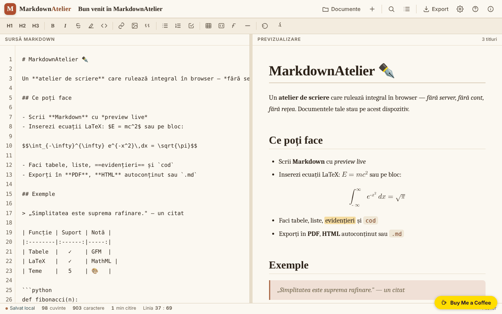

# MarkdownAtelier

[English](README.md) · **Română** · [Français](README.fr.md) · [Italiano](README.it.md) · [Español](README.es.md) · [Português](README.pt.md) · [Deutsch](README.de.md) · [Magyar](README.hu.md)

**Versiune:** 2.2.0 · **Ultima actualizare:** 2026-10-27

**Stare:** stabil · **Offline:** complet

Limbile interfeței: **Română, English, Français, Italiano, Español, Português (PT), Deutsch, Magyar**

Atelier de scriere Markdown cu previzualizare, export și documente salvate local.

**Live:** https://chiuta.github.io/MarkdownAtelier/



## Ce este

MarkdownAtelier este un editor Markdown dintr-un singur fișier HTML, cu previzualizare în paralel, gestionar de documente, căutare/înlocuire și export în .md, .html și PDF (prin tipărire). Documentele rămân în browserul tău.

## Funcții

- Editor („Editor") și previzualizare („Preview"), cu scroll sincronizat opțional și „Mod focus".
- Bară de formatare (H1, H2, H3, B, I etc.), contor de cuvinte, caractere și minute de citire, indicator „Linia : coloana".
- Sintaxă: titluri, bold, italic, tăiat, ==evidențiat==, cod inline, ~sub~, ^sup^, liste și checklist, citate, tabele GFM, note de subsol, blocuri de cod cu limbaj, ecuații `$inline$` și `$$bloc$$` (LaTeX convertit în MathML nativ), cuprins automat `[[toc]]`, detalii pliabile `::: details`.
- Setări: temă, limba interfeței (English, Română, Français, Italiano, Español, Português, Deutsch, Magyar), word wrap, numere de linie, auto-numerotare titluri în cuprins, tipografie inteligentă, coduri emoji (`:rocket:` devine 🚀), dimensiunea textului.
- Documente: „Importă .md", „＋ Document nou", listă de documente cu căutare (în titluri și text), „Backup .json" (toate documentele într-un fișier) și „Restaurează" (adaugă documentele dintr-un backup, fără a le suprascrie pe cele existente).
- La prima rulare, fără setări salvate, aplicația alege tema întunecată „midnight" dacă sistemul o preferă.
- Export: .md, .html autoconținut, PDF (print), „Copiază HTML în clipboard"; panou de cuprins și ajutor cu sintaxa.
- **Export Word `.docx` (2.1.0):** „↓ .docx” în panoul Export (trece și prin verificarea datelor personale). Generat în browser, fără bibliotecă: un mic scriitor ZIP (CRC-32) + WordprocessingML produs din același HTML ca previzualizarea. Păstrează titlurile (Heading 1-6, deci panoul de navigare din Word funcționează), îngroșat/italic/tăiat/marcat/indice/exponent, cod inline, linkuri, liste cu buline și numerotate (imbricate, fiecare `ol` reîncepe de la 1), liste de sarcini (☑/☐), citate, tabele (rând de antet, aliniere pe coloane), blocuri de cod (monospațiat, cu fundal), linii orizontale, note de subsol și blocuri pliabile (ca text simplu). **Limite:** imaginile devin textul lor alternativ între paranteze drepte; ecuațiile sunt scrise ca text liniar (`E=mc^2`, `(a)/(b)`), nu ca ecuații Word native; codul nu are colorare sintactică; linkurile interne (`#...`) devin text simplu; fișierul nu e comprimat (ZIP „stored”). **Verificat** cu pandoc și LibreOffice (se deschide și se convertește în PDF); **netestat cu Microsoft Word** - de verificat pe o instalare reală.
- **Existente deja (fără modificări în 2.1.0):** *modul focus* (Setări → „Mod focus”) și *istoricul local al versiunilor* (ramuri, diferență pe cuvinte, îmbinare în 3 direcții; vezi 2.0.0).
- **Diagrame Mermaid (2.2.0, subset compact):** un bloc ```` ```mermaid ```` cu `flowchart`/`graph` (TB/TD/BT/LR/RL, forme de noduri `[ ] ( ) ([ ]) (( )) { }`, săgeți `--> --- -.-> ==>` cu etichete, lanțuri, cicluri) sau `sequenceDiagram` (`participant`/`actor`, `->> -->> -> --> -x -)`, note, mesaje către sine) este desenat local ca SVG inline, cu culorile temei și tipărire corectă. Sintaxa nesuportată (`subgraph`, `style`/`classDef`, `loop`/`alt`, `activate`, `&`, alte tipuri de diagrame) sau depășirea limitelor (60 noduri, 120 conexiuni, 24 participanți, 150 evenimente) afișează un mesaj clar cu numărul liniei (8 limbi; fr/it/es/pt/de/hu sunt traduceri automate), iar sursa rămâne bloc de cod. Aranjarea este proprie și mai simplă decât cea din Mermaid oficial; nu este o implementare completă Mermaid.
- **PDF prin tipărire (exista deja):** butonul „PDF” / Shift+P, foaie de stil pentru tipărire; exportul rămâne tipărirea din browser → „Salvează ca PDF”.
- **Planificat (neimplementat):** alte tipuri Mermaid (class, state, ER, gantt, pie...), `subgraph` și stilizare, și *fișier PDF nativ* (un scriitor PDF făcut de mână nu merită riscul unei tipografii mai slabe).

## Funcții noi (1.1.0)

- **Verificare locală de date personale înainte de export sau copiere** (`FFF.pii`): la „↓ .md”, „↓ .html”, „🖨 PDF” și „Copiază HTML” (și la Ctrl+Shift+P), aplicația caută în browser e-mailuri, telefoane, IBAN (mod 97), CNP (cifră de control), carduri (Luhn), IP, chei/token-uri, adrese și nume (ultimele cu încredere scăzută). Dacă găsește ceva, nu exportă până alegi: „Maschează bifatele și continuă”, „Continuă fără mascare” sau „Anulează”. **Documentul din editor nu este modificat**: se exportă doar o copie mascată. Opțiunea se poate opri din panoul Export (preferința se păstrează).
- **„🛡 Verifică acum documentul”** (panoul Export): scanează documentul curent; dacă găsește date personale, poți crea un **document nou** cu ele mascate (originalul rămâne neatins).
- **Căutare locală după sens în documente** (`FFF.search`: BM25, normalizare de diacritice, forme apropiate, fragmente evidențiate; fără rețea). Înlocuiește potrivirea simplă de subșir, cu aceeași interfață; dacă kitul lipsește, se folosește varianta veche.
- **Indicator de confidențialitate** în panoul „Documente”: documentele rămân pe dispozitiv, aplicația nu face cereri de rețea (CSP: `default-src 'self'`, fără `connect-src`; verificat în test: 0 cereri). Eticheta de transparență (apasă versiunea din „Despre”) oferă export/import/ștergere `.fff.json` cu criptare opțională cu parolă (AES-GCM, PBKDF2).
- **Accesibilitate:** ferestrele modale au acum `role="dialog"`, `aria-modal` și nume, iar notificarea (`#toast`) este regiune `status`; axe-core: 0 violări (înainte, panoul Export avea o violare „region”).

### 1.2.2 — 2026-10-22
- Tooltip-urile din bara de unelte și căutare, etichetele de accesibilitate, placeholderul editorului, ajutorul de sintaxă, butoanele blocurilor de cod și titlul/descrierea paginii sunt traduse în toate limbile; documentul de bun venit nemodificat urmează limba interfeței.

### Limite
- Detecția de date personale este euristică: poate rata sau semnala greșit. Nu înlocuiește verificarea ta înainte de a publica un text.
- Se scanează doar textul Markdown, nu imaginile sau fișierele atașate prin data-URI.
- Traducerile textelor noi în fr/it/es/pt/de/hu sunt automate și **neverificate nativ**.

**Kit FFF.** Din `fff-kit` (lipit în `index.html`, fără rețea) se folosesc `core, label, bundle, pii, search`. Politica CSP **nu a fost schimbată** în afară de hash-urile `sha256` ale scripturilor inline (stilul dialogului de date personale este injectat în `<style>`, acoperit de `style-src 'unsafe-inline'` deja prezent; nicio gazdă nouă).

## Manual de utilizare

Scurtături de tastatură (afișate în aplicație):

- Ctrl B îngroșat, Ctrl I italic, Ctrl K link, Ctrl ` cod inline
- Ctrl F caută / înlocuiește
- Ctrl S salvează
- Ctrl E export
- Ctrl O documente
- Ctrl Alt N document nou
- Tab indentare

Pași:

1. Scrie în panoul „Sursă Markdown"; previzualizarea apare alături; comutatoarele ✍️ Editor și 👁️ Preview aleg panoul afișat.
2. Gestionează documentele din „Documente" (Ctrl O): „Importă .md" sau „＋ Document nou".
3. Exportă din „Export" (Ctrl E): „↓ .md", „↓ .html", „🖨 PDF" (se alege „Salvează ca PDF" în dialogul de tipărire) sau „⧉ Copiază".
4. Ajustează tema, limba și opțiunile din „Setări".
5. Pentru a șterge tot ce a salvat aplicația, folosește „Șterge toate datele" din Setări.

## Confidențialitate și rețea

- Documentele și setările se păstrează în `localStorage` (chei `markdownatelier.v1` și `markdownatelier.settings.v1`); indicatorul „Salvat local" arată starea.
- Politica CSP nu mai permite scripturi inline arbitrare (`script-src` pe hash SHA-256, fără `'unsafe-inline'`).
- Aplicația nu face cereri de rețea (fără `fetch`, CDN sau scripturi externe). Conține doar link-uri, deschise la click, către Buy Me a Coffee și chiuta.github.io.
- Datele nu se sincronizează între dispozitive; pentru backup exportă fișierele.

## Rulare locală / offline

Descarcă `index.html` și deschide-l în browser; nu necesită internet.

## Istoric / Changelog

### 2.2.0 — 2026-10-27
- Subset Mermaid (flowchart/graph și sequenceDiagram) desenat local ca SVG, cu mesaj clar pentru sintaxă nesuportată; teste în `tests/mermaid.test.mjs` (30 de verificări). PDF-prin-tipărire exista deja și este acum documentat.

### 2.1.0 — 2026-10-27
- Export nou în Word `.docx`, fără bibliotecă (scriitor ZIP + WordprocessingML), trecut și prin verificarea datelor personale; teste în `tests/docx.test.mjs` (45 de verificări; validat și cu pandoc și LibreOffice).
- Documentat: modul focus și istoricul versiunilor există deja; Mermaid și fișierul PDF nativ sunt marcate ca planificate.
- Texte în 8 limbi (fr/it/es/pt/de/hu sunt automate, neverificate de vorbitori nativi).

### 2.0.0 — 2026-10-26

- **Versiuni ramificate** (butonul „Istoric”): salvezi versiuni ale documentului, creezi ramuri din textul curent, treci între ele, compari orice versiune cu textul curent (diferență pe cuvinte) și restaurezi. **Îmbinarea** unei ramuri în alta e în trei (bază comună, pe linii): modificările separate se combină, iar cele care se bat cap în cap apar cu marcaje `<<<<<<<` / `=======` / `>>>>>>>` de rezolvat. Totul stă local, în documentul din localStorage.
- **Comentarii ancorate** pe fragmentul selectat: rămân în document, se regăsesc după editări (cu „↦” sari la fragment) și nu apar în exporturi. Interfața e tradusă în toate cele 8 limbi.

### 1.2.9 — 2026-10-23

- Markdown: URL-ul unui link (`[a](https://site/_x_/y)`) era alterat de regulile de emfază (`_ * ~ ^ ==` deveneau `<em>`/`<sub>`/`<mark>` în `href`); etichetele de deschidere ale linkurilor și imaginilor sunt acum protejate. Nu s-a găsit niciun XSS.

### 1.2.8 — 2026-10-23

- Audit fff-kit 1.2.0: avertismentul de paritate i18n este o alarmă falsă (cheile se completează la rulare); documentat ca excepție justificată în `fff.config.json`. Fără schimbări funcționale.

### 1.2.6 — 2026-10-22

fff-kit 1.1.4: ținte tactile și text minim. Ținte tactile/text corectate în aplicație.

### 1.2.5 — 2026-10-22

fff-kit 1.1.2: PBKDF2 600 000 iterații, protecție anti-clickjacking.

### 1.2.4 — 2026-10-22
- Un singur H1 pe pagină: un „# Titlu” din document apare în previzualizare ca H2 cu același aspect.
- Pe ecrane înguste bara de formatare se rupe pe mai multe rânduri în loc să fie tăiată lateral; butoanele sunt mai mari (36 px).
- Dialogurile confirm() native (ștergere document, ștergerea totală) au fost înlocuite cu un dialog accesibil, tradus.
- Mobil: niciun text sub 12 px și ținte tactile de cel puțin 24 px (WCAG 2.5.8).

- **1.2.3 — 2026-10-22:** butoanele „Înlocuiește” și „Toate” din bara de căutare și eticheta de accesibilitate a selectorului de limbă sunt acum traduse în toate limbile (fără rămășițe în română).
- **1.1.0 — 2026-10-14:** verificare locală de date personale înainte de export/copiere (`FFF.pii`), „Verifică acum” cu document nou mascat, căutare locală după sens (`FFF.search`), indicator de confidențialitate, etichetă de transparență și copie criptată (`FFF.bundle`), `role="dialog"` pe ferestre; teste în `tests/fff-r8.test.mjs`.
- 1.0.0 — 2026-10-12: versiunea și data ultimei actualizări sunt afișate în aplicație
- Runda 7: `~sub~` funcționează și în mijlocul cuvintelor (H~2~O, CO~2~); un document nou primește automat titlul primului titlu Markdown (`# ...`) cât timp titlul nu a fost editat manual; contrast mai bun pentru textul ~~tăiat~~.
- Pe ecrane înguste (360 px) bara de sus și bara de stare nu mai depășesc ecranul; titlul documentului trece pe rând separat, iar butonul Setări este vizibil.
- Comutatorul „Editor / Preview" apare acum pe mobil (era ascuns de o regulă CSS suprascrisă).
- Documente: căutare în titluri/conținut, Backup .json și Restaurează (cu validare și mesaj de eroare); temă întunecată implicită la prima rulare dacă sistemul o preferă; CSP `script-src` pe hash în loc de `'unsafe-inline'`.
- Adăugat titlu de nivel 1 (ascuns vizual) pentru cititoarele de ecran; verificare axe-core: 0 violări la 1280 și 360 px.

## Licență

MIT — vezi fișierul LICENSE

## Autor

Alexio — Alexandru-Ionuț Chiuță, contact: alexio@trom.tf

## Rezumat

MarkdownAtelier este un editor Markdown într-un singur fișier, cu previzualizare în direct, manager de documente, căutare/înlocuire, ecuații LaTeX-în-MathML, tabele, note de subsol și export în .md, .html și PDF (prin tipărire). Documentele se păstrează în localStorage al browserului. 8 limbi de interfață. Fără cereri de rețea.
